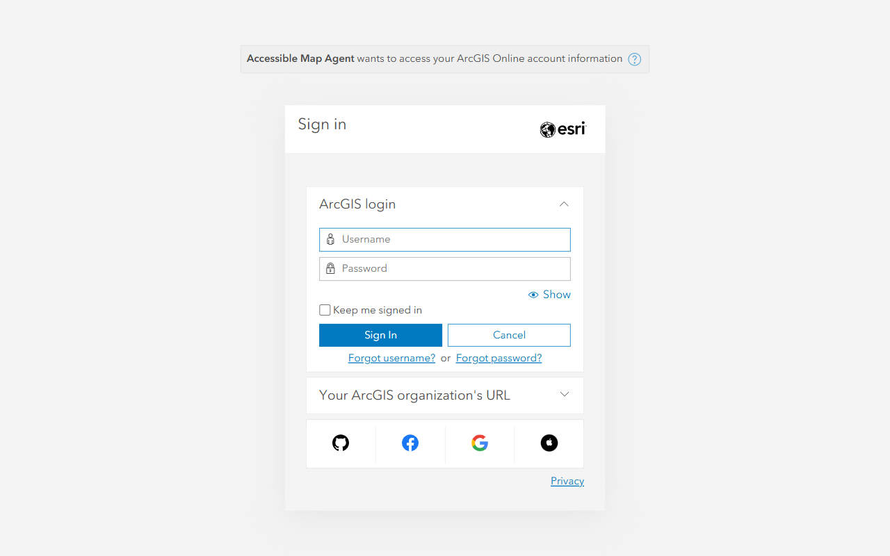
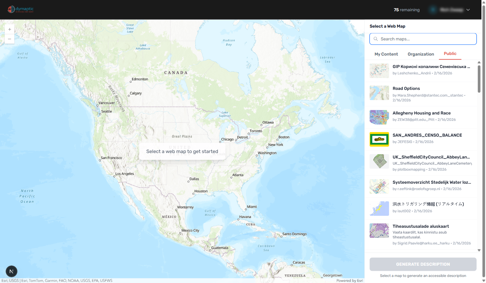
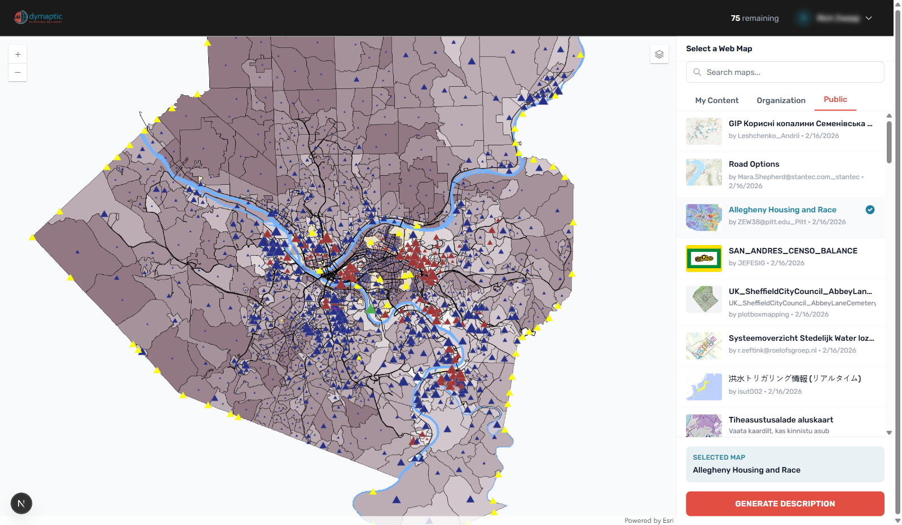
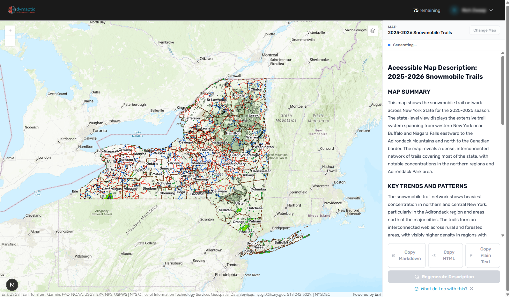
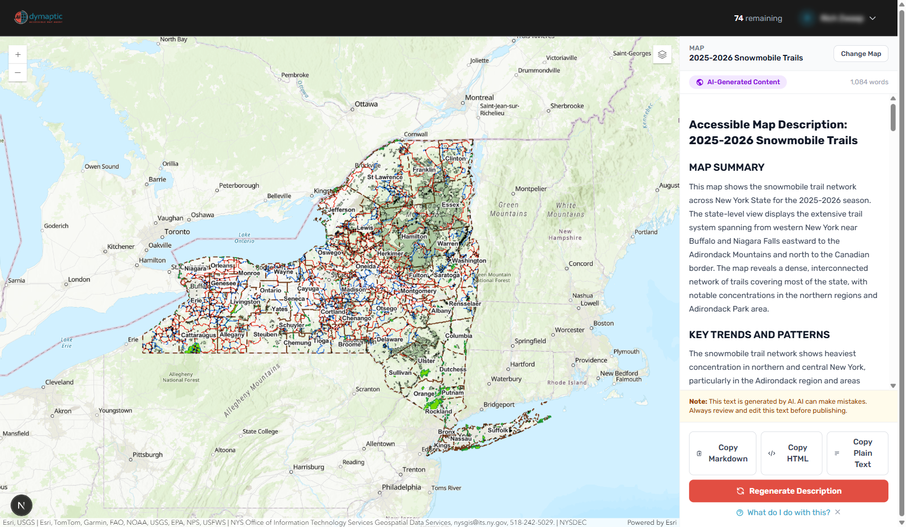
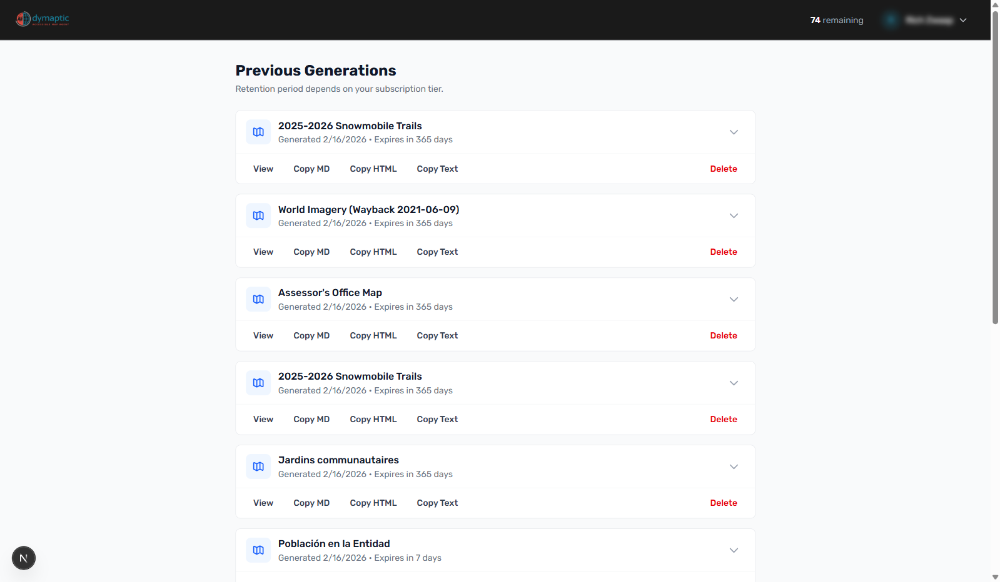

# Quick Start Guide

## Introduction

Accessible Map Agent is an AI-powered web application that generates alternative-text descriptions for ArcGIS web maps, which can help with ADA compliance. These detailed descriptions make your maps accessible to blind and low-vision users by providing a complete textual alternative that conveys the same geographic information a sighted user would gain from viewing your map.

Whether you are a GIS professional preparing for ADA Title II compliance, a government agency meeting WCAG 2.1 requirements, or anyone who wants to make geographic information more inclusive, Accessible Map Agent helps you create professional-quality accessible descriptions in seconds rather than hours.

---

## Prerequisites

Before you begin, make sure you have the following:

- **ArcGIS Online Account** - A free or organizational ArcGIS Online account. You will sign in using your existing ArcGIS credentials.
- **Supported Browser** - A modern web browser:
  - Chrome (recommended)
  - Microsoft Edge
  - Firefox
  - Safari
- **A Web Map** - An ArcGIS web map you want to make accessible. This can be a map you created, a map shared within your organization, or a public map.

---

## Step 1: Sign In with ArcGIS

1. Open your browser and navigate to [https://accessibility.dymaptic.ai](https://accessibility.dymaptic.ai).
2. Click the **Sign in with ArcGIS** button or the **Try it Now** button on the landing page.
3. You will be redirected to the ArcGIS Online authentication page.
4. Enter your ArcGIS Online username and password.
5. Complete the sign-in process.

Your credentials are entered directly on Esri's servers. Accessible Map Agent never sees or stores your ArcGIS password.

---

## Step 2: Select Your Map

Once signed in, you will see the main application interface with a map picker panel on the right side.

1. Browse your available maps using the three tabs:
   - **My Content** - Maps you have created
   - **Organization** - Maps shared within your ArcGIS organization
   - **Public** - Public ArcGIS Online maps
2. Use the search box to find a specific map by name.
3. Click on a map to load it in the preview panel on the left.

4. Once selected, the map loads in the left panel showing all visible layers at the saved extent.

**Tip:** Before generating, you can pan and zoom the map to show exactly what you want described. The AI describes the current view, not the entire map dataset.

---

## Step 3: Generate Description

1. With your map loaded and positioned at the desired view, click the **GENERATE DESCRIPTION** button.
2. Watch as the description appears in real-time, streaming word by word.
3. The generation typically takes 30 to 60 seconds depending on map complexity.

The AI analyzes both the visual appearance of your map and the underlying layer metadata to produce an accurate, contextually aware description.

---

## Step 4: Review Your Description

Once generation completes, review the structured description that appears. The description is organized into clearly labeled sections designed for screen reader navigation:

- **MAP SUMMARY** - A 2-3 sentence overview of what the map shows and why it matters
- **KEY TRENDS AND PATTERNS** - The main spatial insights and relationships visible on the map
- **TABLE OF CONTENTS** - Navigation links for longer descriptions
- **GEOGRAPHIC CONTEXT** - Location, extent, scale, and coordinate reference information
- **VISIBLE FEATURES** - Layer-by-layer breakdown of what is shown on the map
- **LEGEND TRANSLATION** - Plain-language description of the map legend and symbology
- **COMPLIANCE METADATA** - Tags indicating accessibility standards alignment

Each section serves a specific purpose for accessibility. Screen reader users can navigate directly to the sections most relevant to them.

---

## Step 5: Copy or Export

When you are satisfied with your description, copy it for use in your applications:

1. Click **Copy as Markdown** - Best for documentation, internal wikis, Word documents, or further editing.
2. Click **Copy as HTML** - Ready to paste directly into a web page or embed alongside your map.

The copied content is now ready to be pasted wherever you need it. You own the output and can edit, customize, or brand it to match your organization's voice.

**Implementation options:**
- In ArcGIS StoryMaps, paste the description into the designated alt-text field
- In custom web applications, work with your development team to add the description as appropriate alternative text
- In documentation, paste and edit as needed

---

## Step 6: View History

All your generated descriptions are saved to your history for easy retrieval.

1. Click on **History** in the navigation to access your previous generations.
2. Browse your past descriptions by map title and date.
3. Click on any entry to view, re-copy, or delete the description.

History retention varies by subscription tier:
- **Free** - 7 days
- **Starter** - 90 days
- **Professional** - 1 year
- **Enterprise** - Unlimited

This history serves as an audit trail demonstrating your organization's accessibility efforts.

---

## Next Steps

Now that you have generated your first accessible map description, here are some ways to continue:

- **Explore different views** - Generate descriptions at different zoom levels. The AI produces scale-appropriate content whether you are viewing a continent or a city block.
- **Try different maps** - Test the tool on various map types to see how descriptions adapt to different data.
- **Review the output** - While AI-generated descriptions are high quality, we recommend reviewing for accuracy and customizing for your specific needs.
- **Learn about using your description** - Read the [Using Your Description](/help/using-your-description) guide to learn how to integrate your description into ArcGIS StoryMaps, Experience Builder, and custom web apps.
- **Optimize your maps** - Check out the [Preparing Your Map](/help/preparing-your-map) guide to learn how to get the most useful descriptions.
- **Upgrade when ready** - When you need more than the free tier provides, explore our [subscription plans](/#pricing) to find the right fit for your organization.

---

## Quick Tips for Best Results

- **Name your layers descriptively** - Layer metadata helps the AI understand what your data represents.
- **Zoom to the most meaningful extent** - The description adapts to what is visible, so show the view that best communicates your map's purpose.
- **Ensure key layers are visible** - The AI describes only what it can see in the current view.
- **Generate multiple descriptions** - For interactive maps where users pan and zoom, consider generating descriptions for multiple key views.
- **Review before publishing** - AI-generated content is a high-quality starting point, but human review ensures accuracy for your specific context.

---

## Need Help?

If you encounter any issues or have questions:
- Check our [FAQ](/#faq) for answers to common questions
- Contact support at support@dymaptic.com

---

*Accessible Map Agent - Making maps accessible to everyone.*
