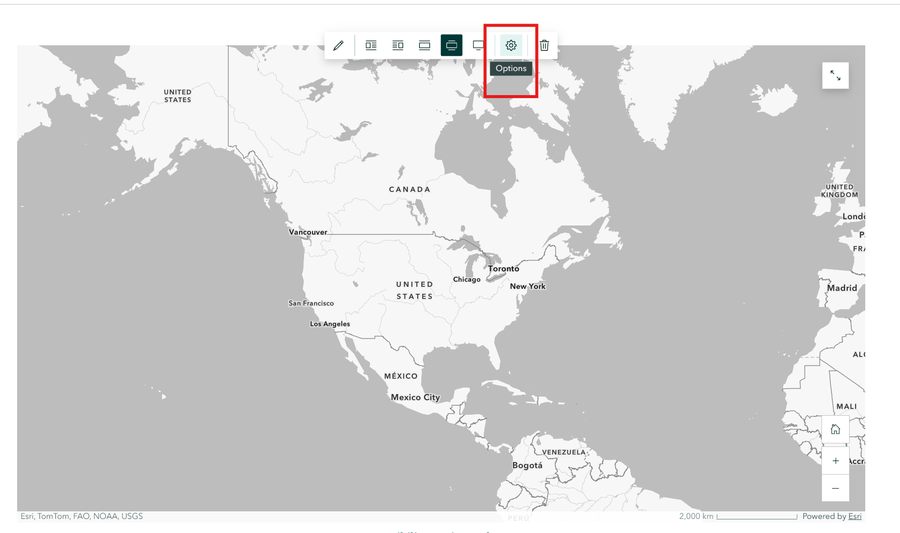
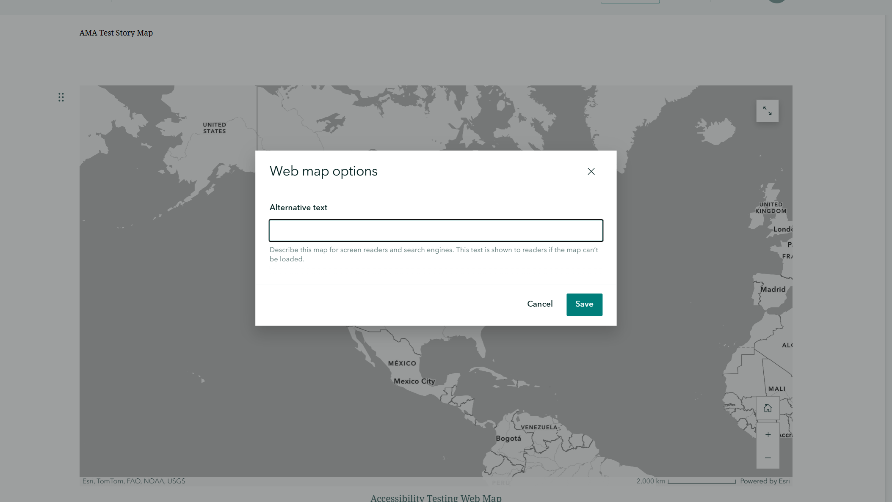
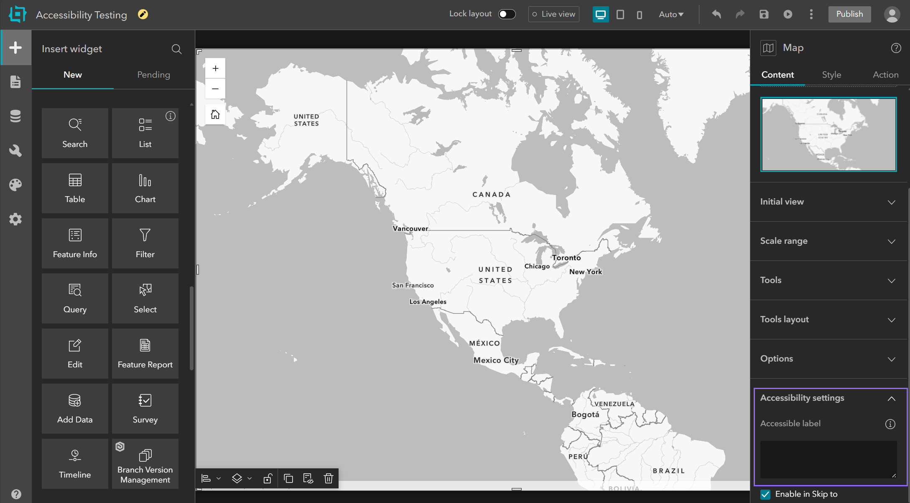

# Using Your Description

Once Accessible Map Agent generates your description, you have a structured document ready to support your accessibility workflow. This guide covers how to integrate your description into common ArcGIS products and other destinations.

For instructions on copying or exporting your description, see the [Quick Start Guide](/help/quick-start#step-5-copy-or-export).

**In this guide:**
- [Understanding Your Description's Structure](#understanding-your-descriptions-structure)
- [Sections in Your Generated Description](#sections-in-your-generated-description)
- [Editing and Customizing Your Description](#editing-and-customizing-your-description)
- [Using Your Description in ArcGIS StoryMaps](#using-your-description-in-arcgis-storymaps)
- [Using Your Description in ArcGIS Experience Builder](#using-your-description-in-arcgis-experience-builder)
- [Using Your Description in Custom Web Apps](#using-your-description-in-custom-web-apps)
- [Using Your Description in Documentation](#using-your-description-in-documentation)

---

## Understanding Your Description's Structure

Maps are information-rich visual media. They communicate location, scale, patterns, relationships, and data all at once through color, symbols, and spatial arrangement. For users who cannot see the map, your generated description assists with providing an equivalent textual experience, translating that visual information into structured prose.

Generated descriptions are organized to support efficient screen reader navigation:

- **Front-loaded structure** - The most critical information (MAP SUMMARY) appears first, so users can decide quickly if the content is relevant
- **Hierarchical headings** - Clear heading structure helps screen reader users understand the organization of the content
- **Section independence** - Each section answers a specific question, so the description remains useful even when read in parts
- **WCAG 2.1 Level AA alignment** - The structure follows accessibility best practices for complex images

The structured format ensures that the description is read in a logical order, with the most important information presented first.

---

## Sections in Your Generated Description

Each generated description is divided into the following sections, presented in this order.

| Section | Purpose | When Screen Reader Users Need It |
|---------|---------|----------------------------------|
| Map Summary | Quick context and key insight | Immediately - to decide if map is relevant |
| Key Trends | Visual patterns translated to text | Understanding the "so what" |
| Table of Contents | Navigation aid | Jumping to specific sections |
| Geographic Context | Location and scale orientation | Understanding where and how much |
| Visible Features | Detailed layer descriptions | Core map content |
| Legend Definitions | Symbol meanings | Quick reference |
| Data Notes | Data context and caveats | Proper interpretation |
| Compliance Metadata | Audit trail | Documentation purposes |

---

## Editing and Customizing Your Description

You own the generated output and can edit it freely. AI-generated descriptions are a high-quality starting point, not a final product.

### When to Regenerate vs. Edit Manually

**Regenerate when:**
- You significantly changed the map view (panned, zoomed, or changed layers)
- The description is fundamentally about the wrong thing

**Edit manually when:**
- The description is mostly correct but needs minor corrections
- You need to add organization-specific context the AI could not know
- You want to emphasize certain elements over others

### Common Customizations

- Adding organizational context (e.g., "This map supports the City's 2025 Floodplain Management Plan")
- Clarifying local terminology your audience uses
- Adding data source attribution not present in layer metadata
- Correcting specific factual details the AI may have misidentified
- Adjusting emphasis to highlight elements most relevant to your audience

### Preserving Accessibility Best Practices

When editing, preserve these elements to maintain the description's effectiveness for assistive technology users:

- **Hierarchical heading structure** - Do not merge or remove section headings
- **Table of contents** - Update it if you change sections
- **Compliance metadata** - These tags document the description's purpose
- **Plain language** - Avoid introducing GIS jargon

---

## Using Your Description in ArcGIS StoryMaps

ArcGIS StoryMaps provides an alternative text field for embedded maps. This is where your generated description belongs, providing the text equivalent that screen readers announce in place of the visual map content.

### Adding Your Description

1. In Accessible Map Agent, click **Copy Plain Text** to copy your generated description to the clipboard.

2. In ArcGIS StoryMaps, open your story and click on the embedded map to select it, then click the **Options** button in the toolbar that appears above the map.



3. Locate the **Alternative text** field in the **Web map options** dialog that opens. The helper text explains this content is shown to screen readers and search engines when the map cannot be loaded.



4. Paste your full description into the Alternative text field.
5. Click **Save** to apply your changes.

### Tips for StoryMaps

- **Paste the full description** to provide the complete accessible alternative. The entire description is what conveys the equivalent information to users who cannot see the map.
- In Accessible Map Agent, **Copy Plain Text** works well since the StoryMaps Alternative text field accepts plain text.
- Test your published StoryMap with a screen reader to verify the description is announced when focus reaches the map.

---

## Using Your Description in ArcGIS Experience Builder

Experience Builder allows you to configure accessibility properties for map widgets through the Accessibility settings panel.

### Adding Your Description

1. In Accessible Map Agent, click **Copy Plain Text** to copy your generated description to the clipboard.
2. In ArcGIS Experience Builder, select your Map widget by clicking on it in the canvas.
3. Scroll down to the **Options** section in the right-hand **Map** configuration panel.
4. Expand **Accessibility settings** to reveal the accessibility configuration fields.



5. Paste your full description in the appropriate accessibility field.
6. Save and publish your experience.

### Tips for Experience Builder

- The full description from Accessible Map Agent provides the comprehensive text alternative for the map widget.
- Test your published Experience Builder app with assistive technology to verify descriptions are exposed correctly.
- For complex layouts with multiple maps, generate a separate description in Accessible Map Agent for each map and ensure each has distinct content that identifies its specific purpose.

---

## Using Your Description in Custom Web Apps

The ArcGIS Maps SDK for JavaScript (version 4.34+) provides an `aria` property on map components that allows you to associate your generated description with the map. Without this property configured, screen readers announce only "application" when a user reaches the map, providing no context about its content or purpose. Setting the `aria` property gives the map a complete textual alternative.

Two properties connect your description to the map:

- **`aria.label`** - Set this to your MAP SUMMARY, the concise overview at the top of your generated description. Screen readers announce this when reading through the page.
- **`aria.describedByElements`** - Set this to an array of DOM elements containing the full description. Screen readers read this content when the map has focus, providing the complete detail.

How you load the description content and connect it to these properties will vary depending on your application. The following example shows a straightforward approach using a hidden container in the page.

**HTML:**

```html
<div id="map-description" hidden>
  <!-- Paste your HTML description here -->
  <h2>MAP SUMMARY</h2>
  <p>This map shows population density across California counties...</p>
  <!-- ... rest of description ... -->
</div>
```

**JavaScript:**

```javascript
const mapElement = document.querySelector("arcgis-map");
const descriptionContainer = document.getElementById("map-description");

mapElement.aria = {
  label: "This map shows population density across California counties...",
  describedByElements: Array.from(descriptionContainer.children)
};
```

With both properties set, the label provides context as the user reads through the page, and the full description becomes available when the map receives focus. This two-level approach offers quick orientation and full detail on demand.

### Learn More

For implementation details and code examples, see Esri's official documentation:

- [Accessibility Guide](https://developers.arcgis.com/javascript/latest/accessibility/) - Overview of accessibility features in the SDK
- [Map Component ARIA Property](https://developers.arcgis.com/javascript/latest/references/map-components/arcgis-map/#aria) - API reference for the aria property

---

## Using Your Description in Documentation

Generated descriptions work well in non-web contexts where maps appear as static images.

### Common Uses

- **Reports and PDFs** - Include the description as a text alternative following the map image. For accessible PDFs, tag the description as alternative text.
- **Word documents** - Paste as formatted text adjacent to the map, or use the alt text properties on embedded images.
- **Internal wikis** - Use Markdown format for platforms like Confluence, Notion, or SharePoint.
- **Accessibility documentation** - The compliance metadata section provides audit trail evidence demonstrating your accessibility efforts.
- **Grant applications and planning documents** - Where maps support analysis or recommendations, include descriptions to ensure all reviewers can access the geographic information.

### Tips for Documentation

- In Accessible Map Agent, use **Copy as Markdown** to preserve headings and formatting for most documentation platforms.
- For PDF accessibility, ensure the description is tagged as alternative text for the map image in your PDF editor.
- The compliance metadata tags from your generated description help categorize descriptions for accessibility audits.
- When including maps in printed materials that will also have digital versions, include the description in both formats.

---

## Need Help?

If you have questions about using your descriptions:
- Check our [FAQ](/#faq) for common questions
- Contact support at support@dymaptic.com

---

*Accessible Map Agent - Making maps accessible to everyone.*
